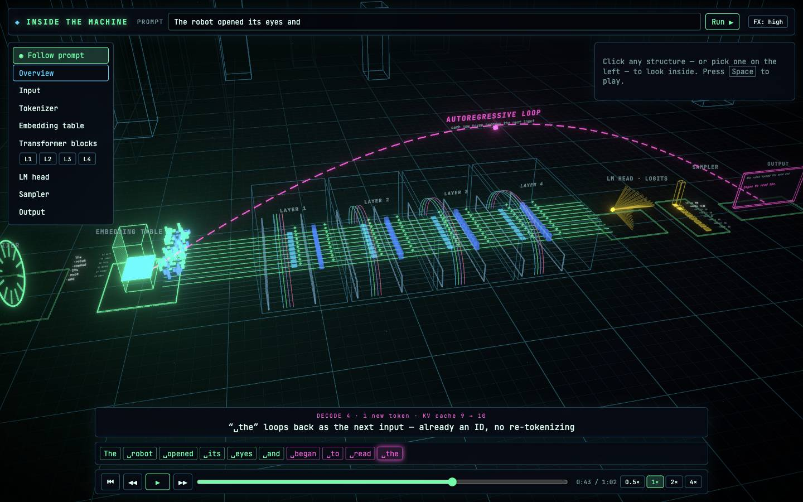
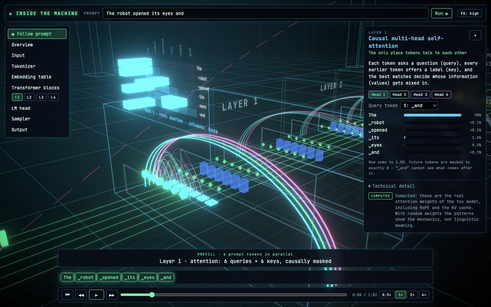
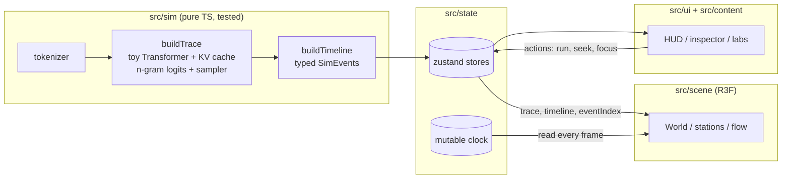

# Inside the Machine

**An interactive 3D journey through a language model.** Cal Hacks 13.0.

Shrink down, step inside a decoder-only Transformer, and watch a prompt become a response one
token at a time: text is split into tokens, tokens become vectors, vectors flow through stacked
attention + MLP layers along the residual stream, the last position is projected to logits, a
sampler picks the next token, and that token loops back in, with cached keys and values doing the
remembering.

The 3D world _is_ the explanation: lanes are token positions, arches are attention (the only place
tokens exchange information), towers are per-token MLPs, glowing tiles are the KV cache, and a
pink arc is the autoregressive loop.




> **Honesty first.** We visualize real computational operations, not an AI's "thoughts". The
> attention numbers come from a genuinely computed (but tiny, random-weight) Transformer; the
> next-token scores come from a transparent n-gram stand-in; the tokenizer imitates BPE. Every
> panel is badged **Computed** or **Illustrative**. See [docs/LLM_PIPELINE.md](docs/LLM_PIPELINE.md).

## Quick start

```bash
npm install
npm run dev        # http://localhost:5173
```

| Command             | What it does                                       |
| ------------------- | -------------------------------------------------- |
| `npm run dev`       | Vite dev server with hot reload                    |
| `npm run build`     | Typecheck + production build to `dist/`            |
| `npm run preview`   | Serve the production build locally                 |
| `npm test`          | Vitest unit tests (simulation core)                |
| `npm run typecheck` | Strict TypeScript, no emit                         |
| `npm run check`     | typecheck + tests + prettier check (run before PR) |
| `npm run format`    | Prettier write                                     |

Requirements: Node 20+ (developed on Node 26), a WebGL2 browser (desktop Chrome/Edge/Firefox/Safari).
Add `?low` to the URL to start with bloom disabled on weak GPUs.

**Controls:** `Space` play/pause · `←/→` step between operations · `Home` reset · `G` guided
camera · `O`/`Esc` overview · drag to orbit, scroll to zoom · click any structure to inspect.

## Architecture in one picture



The simulation produces an immutable `InferenceTrace` and a `Timeline` of typed `SimEvent`s.
The scene and UI only _read_ those structures, so a recorded trace from a real model can replace
the simulated one without touching any 3D code. Details: [docs/ARCHITECTURE.md](docs/ARCHITECTURE.md).

## Repository map

```
src/
  app/        App shell, error boundaries, WebGL fallback          (Architect)
  core/       Shared types, config, theme tokens, formatting      (Architect; theme: Graphics; config: Sim)
  state/      zustand stores, playback clock, focus resolution    (Architect)
  sim/        Tokenizer, toy Transformer, sampling, trace, timeline, selectors + tests   (LLM Simulation)
  scene/      R3F canvas, stations, data-flow effects, camera     (Graphics)
  ui/         HUD, playback, inspector, labs, onboarding          (UX)
  content/    Educational copy                                    (UX)
docs/         Vision, architecture, pipeline, interfaces, plans, task board
agents/       Role briefs for AI coding agents
AGENTS.md     Rules for anyone (human or agent) editing this repo
```

## Documentation

- [Project vision](docs/PROJECT_VISION.md): pitch, audience, experience, visual identity
- [Architecture](docs/ARCHITECTURE.md): modules, data flow, rendering, state
- [LLM pipeline](docs/LLM_PIPELINE.md): the accurate pipeline, its 3D mapping, and limitations
- [Interfaces](docs/INTERFACES.md): the contracts that make parallel work possible
- [Tech stack](docs/TECH_STACK.md): choices and tradeoffs
- [Design system](docs/DESIGN_SYSTEM.md): colors, grammar, camera, UI
- [Implementation plan](docs/IMPLEMENTATION_PLAN.md): milestones, P0/P1/P2, risks
- [Task board](docs/TASK_BOARD.md): who does what next
- [Demo plan](docs/DEMO_PLAN.md): the 3-minute judge demo and fallbacks

## Deploying

The build is fully static (`dist/`), with no backend, API keys, or CDN fonts. Base path is
relative, so it works on Vercel, Netlify, or GitHub Pages sub-paths:

```bash
npm run build && npx vercel deploy dist --prod   # or drag dist/ into Netlify
```

## Credits

Built with [three.js](https://threejs.org), [React Three Fiber](https://r3f.docs.pmnd.rs),
[drei](https://drei.docs.pmnd.rs), [postprocessing](https://github.com/pmndrs/postprocessing),
[zustand](https://zustand.docs.pmnd.rs) (all MIT) and the JetBrains Mono font (OFL-1.1 via
@fontsource). Conceptual inspiration: Brendan Bycroft's [LLM Visualization](https://bbycroft.net/llm),
Jay Alammar's _The Illustrated Transformer_, and _Transformer Explainer_ (Georgia Tech). No code
was copied from those projects.
