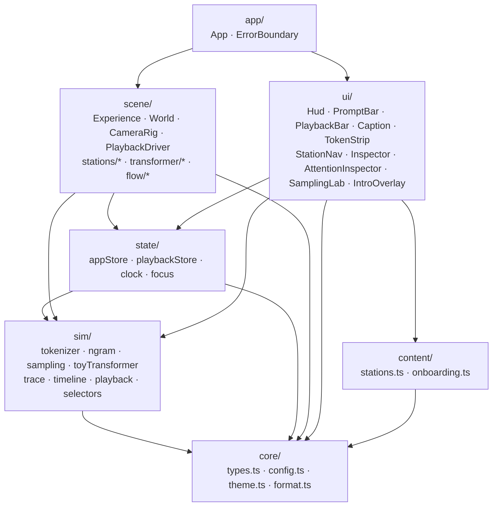
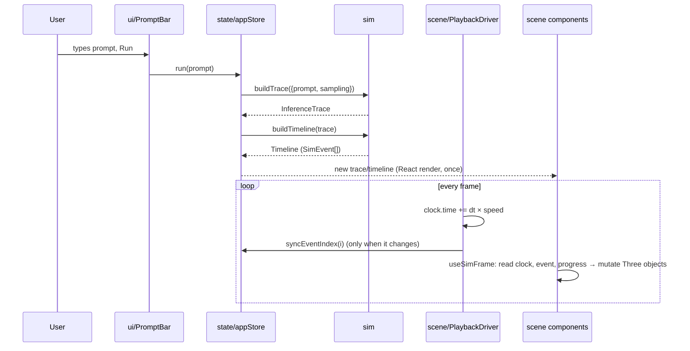

# Architecture

Owner: Architect. Contracts referenced here are specified in [INTERFACES.md](INTERFACES.md).

## Principles

1. **Data first, pixels second.** The simulation produces a complete, immutable
   `InferenceTrace` up front. Rendering is a pure function of `(trace, timeline, time)`.
2. **One-way flow.** `sim → state → (scene, ui)`. Scene and UI never call the simulator directly;
   they call store actions (`run`, `seek`, `focusOn`), which do.
3. **Frame-rate work stays out of React.** The playback clock is a mutable object read inside
   `useFrame`. React re-renders only when something coarse changes (trace, event index, focus).
4. **Replaceable data source.** Anything that produces a valid `InferenceTrace` (the toy simulator
   today, an offline GPT-2 recording tomorrow) drives the same world.
5. **Every number has provenance.** `computed | illustrative | recorded`, shown in the UI.

## Module map



Import rules (enforced by review, see AGENTS.md):

- `core` imports nothing from the app.
- `sim` imports only `core`. No React, no Three.js. 100% unit-testable in Node.
- `scene` may import `core`, `sim` (public API `@/sim` only), and `state`. Never `ui`.
- `ui` may import `core`, `sim` (public API), `state`, `content`. Never `scene`.
- `scene` and `ui` share nothing except state and core. That's what lets two people work without conflicts.

## Data flow



### Simulation (`src/sim`)

| File                | Responsibility                                                                                        |
| ------------------- | ----------------------------------------------------------------------------------------------------- |
| `tokenizer.ts`      | `Tokenizer` interface + illustrative BPE-like tokenizer (round-trips exactly)                         |
| `toyTransformer.ts` | Real pre-norm decoder math: RMSNorm, RoPE, causal MHA with **KV cache**, GELU MLP, residuals          |
| `ngram.ts`          | Interpolated trigram over a tiny corpus, the readable stand-in for LM-head logits                     |
| `sampling.ts`       | Temperature → top-k → top-p → inverse-CDF sampling (HF ordering)                                      |
| `trace.ts`          | `buildTrace`: tokenize, prefill, decode loop, stop conditions → `InferenceTrace`; `attentionMatrix()` |
| `timeline.ts`       | `buildTimeline`: trace → sequential `SimEvent[]` with pacing (later decode steps fast-forward)        |
| `playback.ts`       | Pure time helpers: `eventIndexAt`, `nextBoundary`, `prevBoundary`, `easeInOut`                        |
| `selectors.ts`      | Derived facts at an event: KV-cache length per layer, emitted tokens, visible attention rows          |
| `index.ts`          | Public API. Other modules import `@/sim` only                                                         |

### State (`src/state`)

- `appStore`: trace, timeline, prompt, sampling, `mode` (`guided | explore`), `focus`,
  `attentionHead`, `samplingDraft`, `quality`, `error`, and actions (`run`, `focusOn`, ...).
- `playbackStore`: `playing`, `speed`, coarse `eventIndex`, transport actions.
- `clock`: `{ time }`, mutable. **Only** `PlaybackDriver` advances it; `seek` sets it.
- `focus.ts`: `focusForEvent(event)` (guided camera policy) and `useResolvedFocus()`: the
  single answer to "what are we looking at", used by both camera and inspector.

Why zustand: tiny, no providers, `getState()` works inside `useFrame` without subscriptions, and
selectors keep re-renders surgical.

### Rendering (`src/scene`)

```
<Canvas>                       Experience.tsx: dpr, fog, quality switch
  PlaybackDriver               advances clock
  CameraRig                    drei CameraControls, setLookAt(…, true) on focus change
  <World>
    Environment                grid, sparkles, background towers
    InputTerminal  TokenizerGate  EmbeddingTable          stations/
    ResidualLanes                                         flow/
    LayerBlock × nLayers       norm gates, head arches, MLP towers, residual nodes   transformer/
    KVCacheTiles  AttentionArcs  AttentionMatrix           flow/
    LmHead  Sampler  OutputScreen                          stations/
    AutoregressiveLoop  TokenPackets                       flow/
  Effects                      Bloom + Vignette (high quality only)
```

Per-frame pattern (every animated component):

```ts
useSimFrame(({ event, progress, trace, delta }) => {
  // read-only inputs → mutate refs (matrices, material opacity, scale)
});
```

Performance rules: instanced meshes for anything per-token (packets, MLP towers, KV tiles,
matrix cells, embedding bars); shared geometries in `materials.ts`; geometry rebuilt only on
event change (attention arcs), never per frame; `AdaptiveDpr`; post-processing toggle.

Spatial layout is centralized in `scene/layout.ts` (stations along +x, token lanes along z,
camera poses). Only Graphics edits it.

### UI (`src/ui`)

A DOM overlay (`Hud`) with CSS grid regions; only panels capture pointer events, so the canvas
remains interactive everywhere else. The scrubber reads the clock via `requestAnimationFrame`
(not React state). Copy lives in `src/content` so wording changes never touch components.

## Modes and navigation

- **Guided** (default): camera follows the active event via `focusForEvent`. Close-ups on layer 1
  during prefill, whole-stack view for later layers, pull back to overview once decoding is
  fast-forwarded. Any manual orbit switches to **Explore** in place (no camera jump).
- **Explore**: focus changes only through clicks on 3D structures or the station nav.

## Error handling and fallbacks

- `TraceError` for invalid input (empty prompt, too many tokens), shown inline in the prompt bar; the
  previous trace stays active.
- WebGL unavailable → `SceneFallback` message; the HUD still works.
- Renderer crash → error boundary around `<Experience>`, HUD keeps working.
- `?low` or the FX toggle disables bloom and caps DPR.
- No network dependency at runtime (fonts bundled; troika glyph fallback avoided via Latin-only
  3D strings, see `showToken3D`).

## Integration strategy for real model data (P1)

1. Offline Python script (TransformerLens or HF `output_attentions=True`) runs GPT-2 small on the
   preset prompts with greedy/seeded sampling.
2. Exports JSON matching `InferenceTrace` (`provenance: 'recorded'`), keeping the top-32 logits per
   step, attention for a subset of layers/heads, and real BPE token IDs.
3. `public/traces/*.json` loaded by a `loadRecordedTrace(url)` in `src/sim/recorded.ts` that
   validates shape and calls the same `buildTimeline`.
4. `ModelConfig.nLayers` may exceed what we draw; `scene/layout.ts` maps "displayed layers" to
   real layer indices (Graphics + Sim agree on a `displayLayers` field before implementing).

Do **not** plan on a hosted LLM API: they don't expose attention weights or hidden states.
