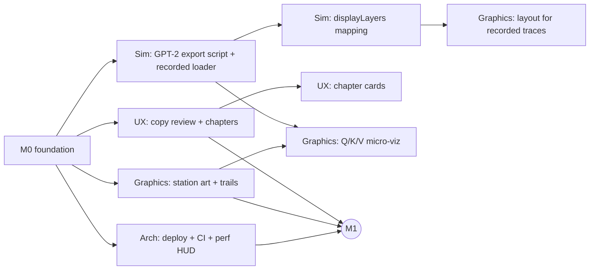

# Implementation Plan

Assumes ~36 hours of hacking with four developers. The rule: **`main` is always demo-able.**
Every milestone ends with a deployed build.

## Scope tiers

### P0: Essential demo (must ship)

| Feature                                                              | Status (end of M0)                |
| -------------------------------------------------------------------- | --------------------------------- |
| R3F app shell, strict TS, build + deploy                             | ✅ done                           |
| Recognizable macro architecture: 7 stations + 4 layer blocks         | ✅ done (placeholder-quality art) |
| Deterministic simulation: tokenize → prefill → decode with KV cache  | ✅ done, 22 tests                 |
| Typed timeline + playback (play/pause/speed/step/scrub/reset)        | ✅ done                           |
| Animated flow: packets, lanes, arcs, cache tiles, loop               | ✅ done                           |
| Guided camera + explore mode + click-to-inspect + station nav        | ✅ done                           |
| Deep dive #1: attention matrix + per-head/per-query inspector        | ✅ done                           |
| Deep dive #2: Sampling Lab (temperature / top-k / top-p, re-run)     | ✅ done                           |
| Educational copy with provenance badges for every station/op         | ✅ first draft                    |
| Intro overlay, error/WebGL fallbacks, low-FX mode                    | ✅ done                           |
| Visual polish pass (station silhouettes, packet trails, readability) | ⏳ M1                             |
| Copy review for accuracy + beginner clarity                          | ⏳ M1                             |
| Deployed URL + rehearsed demo script                                 | ⏳ M1 / M3                        |

### P1: High value

1. **Recorded GPT-2 traces** for the preset prompts (offline Python → JSON, `provenance:
'recorded'`). Turns "illustrative" logits/tokenizer into real ones. _Highest educational ROI._
2. **Real BPE tokenizer** toggle (`gpt-tokenizer`, lazy-loaded) in a tokenizer playground.
3. **Q/K/V micro-visualization**: show a token's vector splitting into Q, K, V packets, the Q·K
   dot product as a beam, and softmax normalization as beams resizing.
4. **Chapters**: guided mode auto-pauses at five key beats with a one-line narrator card.
5. **Packet trails + shader polish**: line trails, scanline/hologram shader on screens, pulse
   shader on lanes keyed to residual norms.
6. **KV-cache on/off comparison**: a toggle that shows how many positions would be recomputed
   without a cache (counter + ghost packets).
7. **Head comparison**: small multiples of all heads' matrices for one layer.
8. **RoPE demo** in the embedding/attention inspector: rotate a 2-D pair by position.
9. Audio: subtle hum + per-event blips (muted by default).

### P2: Stretch (never at the expense of P0/P1)

- Live instrumentation: a local Python server streaming real traces for arbitrary prompts.
- Logit lens (decode the residual stream at every layer).
- More layers / scalable layout for 12-layer traces with level-of-detail.
- First-person "walk" mode; WebXR.
- Multiplayer shared exploration.
- Mobile layout.

**Explicitly not doing before P0 is polished:** multiplayer, backend, in-browser model inference.

## Milestones

| Milestone                      | Hours | Exit criteria                                                                                                                      |
| ------------------------------ | ----- | ---------------------------------------------------------------------------------------------------------------------------------- |
| **M0 Foundation** ✅           | 0–3   | This commit: runnable end-to-end journey, docs, contracts, tests                                                                   |
| **M1 Vertical slice polish**   | 3–12  | Fresh-eyes test: a non-ML friend narrates the journey correctly after one guided run. 50+ FPS on the weakest team laptop. Deployed |
| **M2 Depth**                   | 12–22 | 2+ P1 items merged (target: recorded GPT-2 trace + Q/K/V micro-viz or chapters). No regressions in M1 criteria                     |
| **M3 Integration & rehearsal** | 22–30 | Feature freeze for new systems. Demo script rehearsed 3×; fallback video recorded; copy reviewed                                   |
| **M4 Buffer**                  | 30–36 | Bug fixes only; stretch work only behind a flag on a branch                                                                        |

## Execution order and dependencies

## Risks and early validation

| Risk                                               | Likelihood | Impact | Validate by                                                             | Mitigation                                                          |
| -------------------------------------------------- | ---------- | ------ | ----------------------------------------------------------------------- | ------------------------------------------------------------------- |
| Scene is pretty but unreadable (clutter, labels)   | High       | High   | M1 fresh-eyes test with 2 non-team people                               | Fewer simultaneous effects; chapters; stronger color grammar        |
| Performance on integrated GPUs (bloom + many Text) | Med        | High   | Run on the weakest laptop at hour 4; `r3f-perf`                         | FX toggle, `?low`, fewer Text meshes, instancing                    |
| Recorded-trace schema mismatch                     | Med        | Med    | Export **one** GPT-2 trace by hour 10 even if unused; load it in a test | Optional fields; loader that maps/validates                         |
| Inaccurate or overclaiming copy                    | Med        | High   | Sim owner reviews all copy against LLM_PIPELINE.md at M1 and M3         | Provenance badges; honesty line mandatory                           |
| Guided camera disorients                           | Med        | Med    | Watch someone use it                                                    | Fewer focus changes; slower smoothTime; overview during fast decode |
| Demo-day network / machine failure                 | Low        | High   | Run the production build offline                                        | Static build, bundled fonts, backup laptop, recorded video          |
| Merge conflicts in shared files                    | Med        | Med    | —                                                                       | Ownership map, small PRs, contract change protocol                  |

## Definition of done (any task)

- `npm run check` and `npm run build` pass.
- Feature works from a fresh reload in guided _and_ explore mode, and after scrubbing backward.
- No console errors; no new per-frame React renders (check React DevTools "highlight updates").
- Docs touched if a contract or behavior changed.
